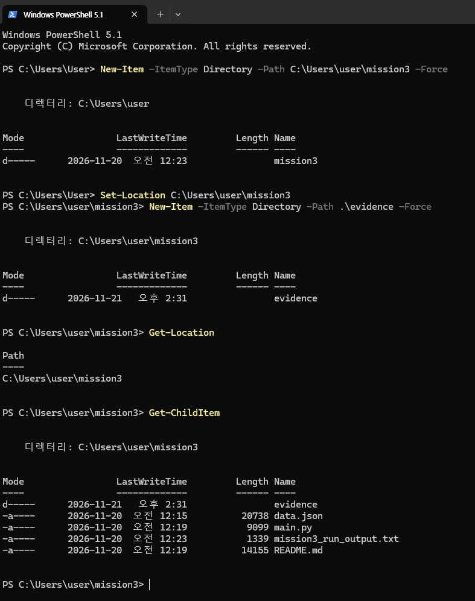
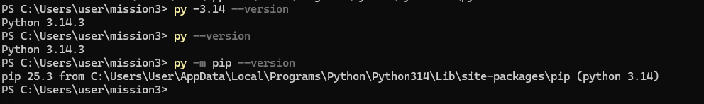
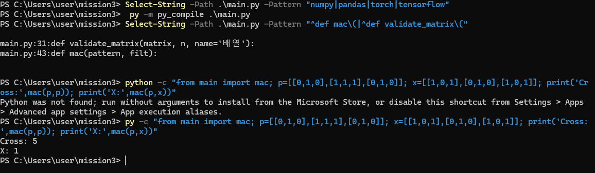
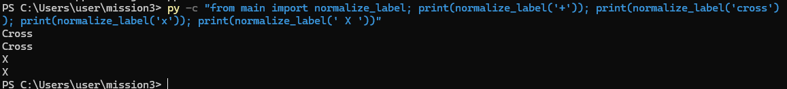
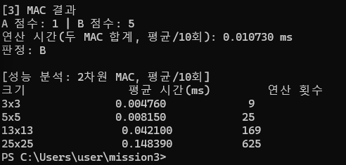
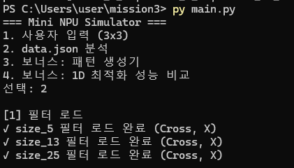
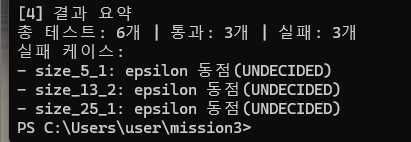
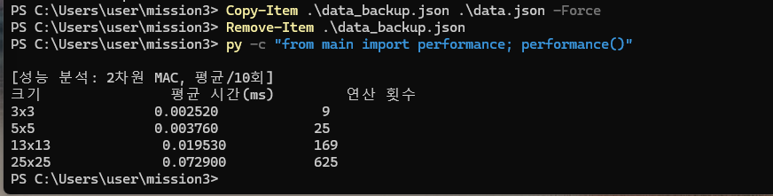
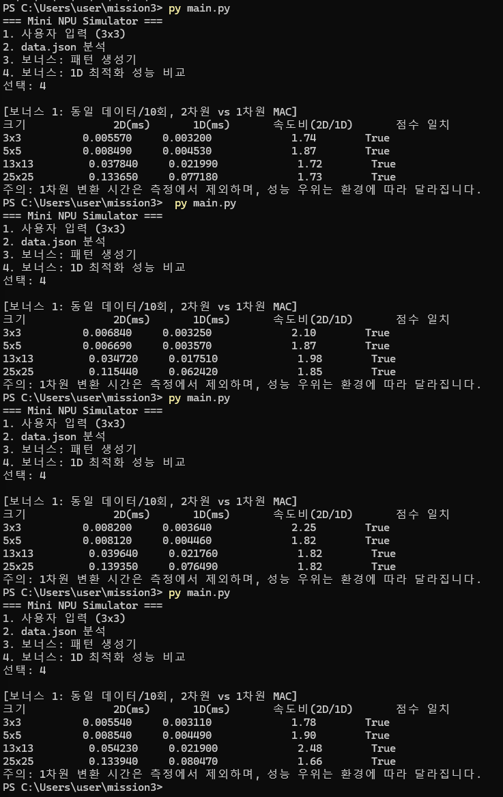
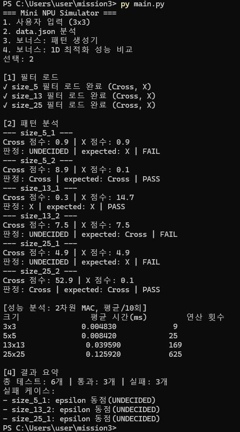

# Mission 3 — Mini NPU Simulator

> 공식 과제의 **필수 기능 → 오류 검증 → 성능 분석 → 보너스 과제 → 결과 리포트 → 제출** 순서로 수행하는 PowerShell 실습 및 증거 수집 보고서. 모든 증거 링크는 맨 아래 **전체 증거자료 목록의 파일명과 1:1 일치**한다. 실제 캡처를 완료하기 전에는 이미지가 표시되지 않는 것이 정상이다.

## 1. 미션 개요 및 준수 사항

- 목표: Cross(+)와 X 패턴을 2차원 숫자 배열로 표현하고 MAC(Multiply–Accumulate) 점수로 판정한다.
- 실행 환경: Windows PowerShell, Python 3.8 이상, 작업 폴더 `C:\Users\user\mission3`.
- **외부 라이브러리 금지:** NumPy, pandas 등은 사용하지 않는다. Python 표준 라이브러리만 사용한다.
- 필수 기능: 사용자 3×3 입력, JSON 일괄 분석, 라벨 정규화, epsilon 동점 판정, 10회 평균 성능 측정, 실패 리포트.
- 보너스: 2차원/1차원 MAC 비교, 홀수 크기 Cross/X 생성기.
- 원본 `data.json`은 제공된 데이터를 수정하지 않고 사용한다. 원본 기준 6개 테스트 중 PASS 3개, FAIL 3개(동점 판정)이다.

## 2. 폴더 구조

```text
C:\Users\user\mission3\
├── main.py
├── data.json
├── README.md
└── evidence\                # 실제 캡처 PNG 22개 저장
```

> `main.py`의 실제 메뉴는 `1. 사용자 입력`, `2. data.json 분석`, `3. 패턴 생성기`, `4. 1D 최적화 성능 비교` 순서이다. 공식 과제의 기본 실행 흐름은 메뉴 1 또는 2를 선택하는 것이다.

## 3. 작업 지시 순서별 실행 절차

### 3.1 개발환경 준비 및 파일 확인 — 요구사항 6, 7

**① 작업 폴더 확인 및 evidence 생성**

```powershell
New-Item -ItemType Directory -Path C:\Users\user\mission3 -Force
Set-Location C:\Users\user\mission3
New-Item -ItemType Directory -Path .\evidence -Force
Get-Location
Get-ChildItem
```

`main.py`, `data.json`, `README.md`를 이 폴더에 저장한 뒤 파일 목록을 확인한다.



**② Python 버전 확인**

```powershell
python --version
python -m pip --version
```

Python 3.8 이상인지 확인한다. pip는 버전 확인용이며 외부 라이브러리는 설치하지 않는다.



**③ 문법 및 외부 라이브러리 제약 확인**

```powershell
Select-String -Path .\main.py -Pattern 'numpy|pandas|torch|tensorflow'
python -m py_compile .\main.py
```

검색 결과가 없고 컴파일 오류가 없는지 확인한다. 문자열 검색만으로 모든 외부 의존성이 없음을 증명하는 것은 아니므로 `import` 문도 직접 확인한다.


### 3.2 데이터 구조·MAC·라벨·epsilon 검증 — 요구사항 4

**④ CPU 기본 MAC 계산**

```powershell
Select-String -Path .\main.py -Pattern '^def mac\(|^def validate_matrix\('
python -c "from main import mac; p=[[0,1,0],[1,1,1],[0,1,0]]; x=[[1,0,1],[0,1,0],[1,0,1]]; print('Cross:',mac(p,p)); print('X:',mac(p,x))"
```

Cross와 Cross의 점수는 5, Cross와 X의 점수는 1이어야 한다. 정수 `5` 또는 실수 `5.0`은 같은 점수다.



**⑤ 라벨 정규화**

```powershell
python -c "from main import normalize_label; print(normalize_label('+')); print(normalize_label('cross')); print(normalize_label('x')); print(normalize_label(' X '))"
```

예상 출력: `Cross`, `Cross`, `X`, `X`.



**⑥ epsilon 동점 정책**

```powershell
python -c "from main import decide; print(decide(0.9,0.8999999999999999)); print(decide(5.0,1.0))"
```

예상 출력: `UNDECIDED`, `Cross`. 현재 코드의 판정은 `math.isclose(..., rel_tol=0.0, abs_tol=1e-9)`이다.


### 3.3 모드 1: 사용자 입력 3×3 — 요구사항 4 및 재현성

**⑦ 실행 및 필터 입력**

```powershell
python main.py
```

메뉴에서 `1`을 선택하고 다음을 순서대로 입력한다.

필터 A (Cross):

```text
0 1 0
1 1 1
0 1 0
```

필터 B (X):

```text
1 0 1
0 1 0
1 0 1
```


**⑧ 패턴 입력 및 판정**

패턴으로 X를 입력한다.

```text
1 0 1
0 1 0
1 0 1
```

A 점수 1, B 점수 5, 판정 B가 나와야 한다. 연산 시간은 컴퓨터마다 달라진다.



**⑨ 잘못된 입력 및 재입력 확인**

다시 `python main.py`를 실행하고 `1`을 선택한다. 필터 첫 행에 `0 1`(열 수 부족)을 입력하고 오류 메시지를 확인한다. 다시 시작된 배열 입력에서 `0 A 0`(숫자 파싱 오류)을 입력해 오류 및 재입력 안내를 확인한다. 이 모드는 잘못 입력한 **배열 전체**를 처음부터 다시 입력받는다.


### 3.4 모드 2: JSON 로드·스키마 검증·판정 — 요구사항 4

**⑩ JSON 파일 문법과 키 확인**

```powershell
python -m json.tool .\data.json > $null
python -c "import json; d=json.load(open('data.json',encoding='utf-8')); print('filters:',list(d['filters'])); print('patterns:',list(d['patterns']))"
```

`filters`에 `size_5`, `size_13`, `size_25`가 있는지, `patterns`의 키가 `size_N_idx` 형식인지 확인한다.


**⑪ 필터 로드**

```powershell
python main.py
```

메뉴에서 `2`를 선택한다. 5×5, 13×13, 25×25 Cross/X 필터가 로드되는지 확인한다.



**⑫ 케이스별 MAC 점수와 PASS/FAIL**

각 패턴의 Cross 점수, X 점수, 판정, expected, PASS/FAIL을 캡처한다. 데이터의 `+`와 `x`는 각각 `Cross`와 `X`로 정규화한다.


**⑬ 전체 결과 요약**

제공된 원본 `data.json`을 기준으로 전체 6개, PASS 3개, FAIL 3개가 예상된다. 실패 식별자는 `size_5_1`, `size_13_2`, `size_25_1`이며 모두 epsilon 동점으로 `UNDECIDED`가 반환된 경우다. 원본 expected나 필터 가중치를 임의로 수정하지 않는다.



**⑭ 크기 불일치 오류를 의도적으로 발생시키고 복원**

원본을 백업한다.

```powershell
Copy-Item .\data.json .\data_backup.json
```

테스트용으로 `size_5_1` 입력의 첫 행을 제거한다.

```powershell
@'
import json
with open('data.json', encoding='utf-8') as f:
    data = json.load(f)
data['patterns']['size_5_1']['input'].pop(0)
with open('data.json', 'w', encoding='utf-8') as f:
    json.dump(data, f, ensure_ascii=False, indent=2)
'@ | python -
```

`python main.py`를 실행하고 메뉴 `2`를 선택한다. 해당 케이스만 데이터/스키마 오류로 FAIL 처리하고 나머지 케이스를 계속 검사하는지 확인한다.


**캡처 직후 원본을 반드시 복원한다.**

```powershell
Copy-Item .\data_backup.json .\data.json -Force
Remove-Item .\data_backup.json
python -m json.tool .\data.json > $null
```

### 3.5 크기별 성능 분석 — 요구사항 4, 과제 목표 3

**⑮ 10회 평균 시간과 N² 연산 횟수**

```powershell
python -c "from main import performance; performance()"
```

| 크기 | 연산 횟수 N² | 평균 실행 시간(ms) |
|---|---:|---|
| 3×3 | 9 | 실제 측정값 기록 |
| 5×5 | 25 | 실제 측정값 기록 |
| 13×13 | 169 | 실제 측정값 기록 |
| 25×25 | 625 | 실제 측정값 기록 |

측정은 각 크기별 10회 반복의 평균이며, 입력·출력·파일 읽기 시간을 제외한 MAC 함수 실행 구간을 대상으로 한다. 측정값은 컴퓨터마다 다르므로 예시 수치를 실제 측정값으로 사용하지 않는다.



### 3.6 보너스 1: 2D → 1D 최적화 — 요구사항 5

**⑯ 배열 변환 확인**

```powershell
Select-String -Path .\main.py -Pattern '^def flatten\(|^def mac_flat\(|^def bonus_benchmark\('
python -c "from main import flatten; print(flatten([[1,2,3],[4,5,6],[7,8,9]]))"
```

예상 출력: `[1, 2, 3, 4, 5, 6, 7, 8, 9]`.


**⑰ 동일 데이터·동일 반복 횟수 성능 비교**

```powershell
python main.py
```

메뉴 `4`를 선택한다. 2D/1D 평균 시간, 속도비, 점수 일치 여부를 확인한다. **현재 구현은 1차원 변환 시간을 측정에서 제외**하므로 이를 README 해석에 명시한다. 1D 방식이 항상 더 빠르다고 단정하지 않는다.



### 3.7 보너스 2: Cross/X 패턴 생성 — 요구사항 5

**⑱ 홀수 크기 패턴 생성**

```powershell
python main.py
```

메뉴 `3`을 선택하고 `5`를 입력한다. Cross는 가운데 행/열이 1이고 X는 양 대각선이 1인지 확인한다. 이 생성 함수는 성능 분석에서도 재사용된다.


**⑲ 짝수 크기 입력 오류 확인**

다시 `python main.py` → 메뉴 `3` → 크기 `4`를 입력한다. `3 이상의 홀수` 안내와 함께 오류가 처리되는지 확인한다.


### 3.8 결과 리포트 및 최종 검증 — 요구사항 4, 7

**⑳ 원본 데이터 복원 및 최종 실행**

```powershell
python -m py_compile .\main.py
python -m json.tool .\data.json > $null
python main.py
```

메뉴 `2`를 선택해 원본 6개 케이스의 최종 결과를 확인한다.



### 3.9 Git/GitHub 제출 및 재현성 확인

**㉑ Git 커밋 및 Push**

```powershell
git status
git remote -v
```

원격 저장소가 연결되어 있지 않다면 **GitHub 웹사이트에서 저장소를 먼저 생성한 뒤** 실제 주소로 연결한다. 기존 `origin`이 있다면 중복 추가하지 않는다.

```powershell
# origin이 없는 경우에만 실행
git remote add origin https://github.com/ntiskang/mission3.git
```

```powershell
git add main.py data.json README.md evidence/
git commit -m "Complete Mission 3 MAC simulator and evidence"
git push -u origin main
```

Push가 실패하면 저장소 존재 여부, 접근 권한, 현재 브랜치, 원격 URL을 확인한다.


**㉒ GitHub에서 증거 링크 확인**

GitHub 저장소의 README에서 이미지가 실제 표시되는지, `evidence` 폴더에 PNG가 올라갔는지 확인한다. `git status`, `git log -1 --oneline`, `git remote -v`로 최종 상태를 재확인한다.


## 4. 결과 리포트

### 4.1 JSON 분석 결과 (제공 원본 데이터 기준)

| 케이스 | Cross 점수 | X 점수 | 판정 | expected | 결과 |
|---|---:|---:|---|---|---|
| size_5_1 | 0.9 | 0.9 | UNDECIDED | X | FAIL |
| size_5_2 | 8.9 | 0.1 | Cross | Cross | PASS |
| size_13_1 | 0.3 | 14.7 | X | X | PASS |
| size_13_2 | 7.5 | 7.5 | UNDECIDED | Cross | FAIL |
| size_25_1 | 4.9 | 4.9 | UNDECIDED | X | FAIL |
| size_25_2 | 52.9 | 0.1 | Cross | Cross | PASS |
| **합계** | | | | | **6건 중 PASS 3, FAIL 3** |

> 위 수치는 제공된 원본 `data.json`에 대한 기존 실행 검증값이다. 실제 제출 전 반드시 현재 컴퓨터에서 재실행하여 확인한다.

### 4.2 실패 원인 분석 및 개선 정책 (10줄 이상)

1. `size_5_1`은 Cross와 X 점수가 모두 0.9이므로 epsilon 동점 정책에 따라 `UNDECIDED`가 된다.
2. 해당 케이스의 예상 라벨은 X이므로 `UNDECIDED != X`가 되어 FAIL이다.
3. `size_13_2`도 두 점수가 7.5로 같아 `UNDECIDED`가 된다.
4. 해당 케이스의 예상 라벨은 Cross이므로 FAIL이다.
5. `size_25_1`도 두 점수가 4.9로 같아 `UNDECIDED`가 된다.
6. 해당 케이스의 예상 라벨은 X이므로 FAIL이다.
7. 이 세 FAIL은 배열 크기 불일치나 JSON 파싱 오류가 아니라 **동점 판정 정책과 기대 라벨 사이의 불일치**이다.
8. `math.isclose`는 부동소수점 표현 오차가 매우 작은 경우도 동점으로 처리하도록 한다.
9. 허용오차가 없으면 `0.9`와 `0.8999999999999999`처럼 사실상 같은 값을 다른 점수로 판단할 수 있다.
10. 라벨 정규화는 `+`·`cross`·`x` 같은 서로 다른 표기를 `Cross`·`X`로 통일한다.
11. 라벨 표기 오류와 수치 비교 오류는 서로 다른 문제이므로 실패 원인을 구분해야 한다.
12. 배열의 행/열 개수가 맞지 않는 경우에는 케이스별 스키마 오류로 처리하여 전체 분석이 중단되지 않도록 한다.
13. 원본 expected나 필터 가중치를 임의로 바꿔 PASS 수를 늘리는 것은 검증의 목적에 맞지 않는다.
14. 향후 개선은 오류 유형별 집계, 동점 케이스에 대한 별도 평가 기준 마련, 경계값 테스트 추가를 중심으로 검토한다.

### 4.3 시간 복잡도 및 측정 해석

MAC 연산은 N×N 행렬의 모든 위치에서 한 번씩 곱셈을 수행하므로 곱셈 횟수는 N²이고 시간 복잡도는 **O(N²)**이다. 3×3은 9회, 5×5는 25회, 13×13은 169회, 25×25는 625회이다. 실측 시간은 반복문 실행 비용, 캐시, 운영체제 스케줄링, Python 인터프리터의 영향을 받는다. 따라서 N² 증가와 측정 시간의 비율이 정확히 같지 않을 수 있다. 실제 측정한 네 크기의 평균 시간을 3.5절 표에 기록하고 연산 횟수와 비교한다.

### 4.4 CPU 2D/1D 비교와 외부 라이브러리 제약

- **CPU 기본 MAC:** 이중 반복문으로 위치별 곱셈과 누적을 직접 구현한다.
- **CPU 1D MAC:** 같은 값을 1차원으로 펼쳐 접근하며, 2D/1D 시간은 동일한 반복 횟수로 측정한다. 변환 비용은 별도 고려한다.
- **NumPy:** 공식 과제에서 외부 라이브러리와 벡터화 MAC을 금지하므로 사용하지 않는다.

## 5. 전체 증거자료 목록

| 번호 | 파일명 | 증명할 내용 |
|---:|---|---|
| 01 | `01_project_directory.png` | 프로젝트 폴더 구성 |
| 02 | `02_python_version.png` | Python 개발환경 |
| 03 | `03_source_validation.png` | 문법 및 라이브러리 제약 확인 |
| 04 | `04_mac_calculation.png` | MAC 연산 정확성 |
| 05 | `05_label_normalization.png` | 라벨 정규화 |
| 06 | `06_epsilon_policy.png` | 동점 판정 정책 |
| 07 | `07_mode1_filters.png` | 사용자 필터 입력 |
| 08 | `08_mode1_mac_result.png` | MAC 점수 및 판정 |
| 09 | `09_mode1_input_error.png` | 잘못된 입력 처리 |
| 10 | `10_json_structure.png` | JSON 구조 및 문법 |
| 11 | `11_json_filter_load.png` | 필터 로드 |
| 12 | `12_json_pattern_results.png` | 케이스별 PASS/FAIL |
| 13 | `13_json_summary.png` | 전체 테스트 결과 |
| 14 | `14_json_schema_error.png` | 배열 크기 오류 처리 |
| 15 | `15_performance_analysis.png` | 크기별 성능 측정 |
| 16 | `16_flatten_conversion.png` | 2D → 1D 변환 |
| 17 | `17_2d_1d_benchmark.png` | 최적화 전후 비교 |
| 18 | `18_pattern_generator.png` | Cross/X 자동 생성 |
| 19 | `19_generator_invalid_size.png` | 패턴 생성 오류 처리 |
| 20 | `20_final_validation.png` | 최종 실행 검증 |
| 21 | `21_git_push.png` | Git 커밋 및 업로드 |
| 22 | `22_github_evidence.png` | GitHub 증거자료 확인 |

## 6. 제출 전 최종 점검

- [ ] Python 3.8 이상이며 외부 라이브러리를 사용하지 않았다.
- [ ] 3×3 입력과 행/열 수 및 숫자 파싱 오류 재입력을 검증했다.
- [ ] 원본 JSON의 필터와 패턴을 검증하고 케이스별 PASS/FAIL을 확인했다.
- [ ] epsilon 동점 정책과 FAIL 원인을 구분해 기록했다.
- [ ] 3×3, 5×5, 13×13, 25×25에 대해 10회 평균 성능을 측정했다.
- [ ] 2D/1D MAC 성능 비교와 Cross/X 생성기 보너스를 검증했다.
- [ ] README의 22개 이미지 링크와 실제 `evidence/*.png` 파일명이 일치한다.
- [ ] GitHub에서 README와 증거 이미지가 정상적으로 표시된다.
